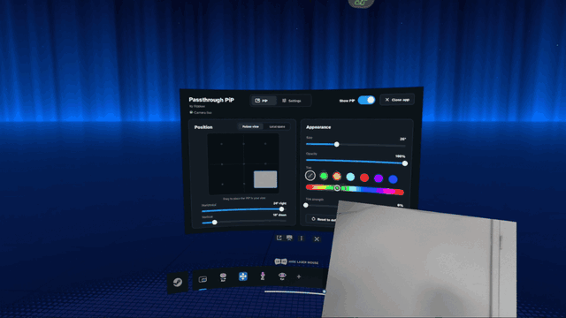
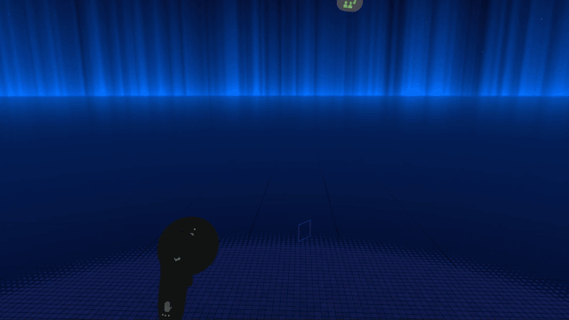
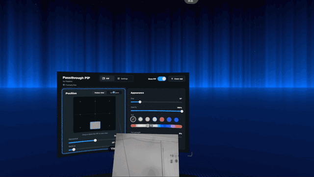

# Passthrough PiP for Steam Frame

A small view of the Steam Frame's passthrough cameras that floats over any game, streamed or standalone. Pin it to a
corner of your view, or place it in the room and move it around with your controllers.

## In action

**Place it in your view** from the SteamVR dashboard:

**Show or hide it** by double-tapping View on the left controller:

**Put it in local space** and carry it around with a controller:

## Install

In Desktop Mode, download `Passthrough_PiP-<version>-aarch64.AppImage` from [Releases](../../releases/latest), open it
and click **Install**. SteamVR restarts once to load the camera driver. Open the AppImage again to **Update** or
**Uninstall**.

## Use

Open the SteamVR dashboard and click the Passthrough PiP icon in the dock.

- **Position > Follow view:** drag the preview to place the PiP in your view.
- **Position > Local space:** the PiP stays put in the room. Point a controller at it (or touch it) and hold grip to
  move it; grip with both controllers and pull apart to resize. **Lock in place** stops it being moved; **Bring to front**
  fetches it.
- **Appearance:** size, opacity and tint.
- **Settings:** start with SteamVR, whether a Local space PiP stays where you left it between sessions, and
  **Edit bindings**, which opens SteamVR's controller bindings for the app.
- **Show / hide from a controller:** double-tap View on the left controller. Change it with **Edit bindings**.

## Good to know

- Camera frames stay on the headset; nothing is saved or sent anywhere.
- Monochrome, about 30 frames per second.
- Not tested with the Arcturus Vision camera accessory.
- Grabbing the PiP with grip can also grab things in a game. Use **Lock in place** if that gets in the way.
- It relies on undocumented SteamVR details, so a SteamOS or SteamVR update can break it. The status line in the panel
  says what's wrong.

## Troubleshooting

- **"Camera driver not loaded"**: restart SteamVR.
- **"Waiting for headset tracking"** or **"Cameras paused"**: put the headset on.
- Logs: `journalctl --user -u framepip`.

Still stuck? [Open an issue](../../issues) with your SteamOS and SteamVR versions (Steam Settings > System), the
status line from the panel, and the output of `journalctl --user -u framepip -b`.

## Building

On a Steam Frame: `packaging/build-appimage.sh` (output in `dist/`). From a PC with ssh access to the headset:
`tools/build-on-frame.sh`.

## Licence

MIT. Third-party notices: `THIRD_PARTY_NOTICES.md`.
